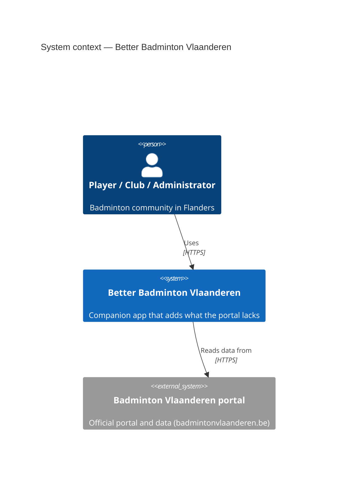
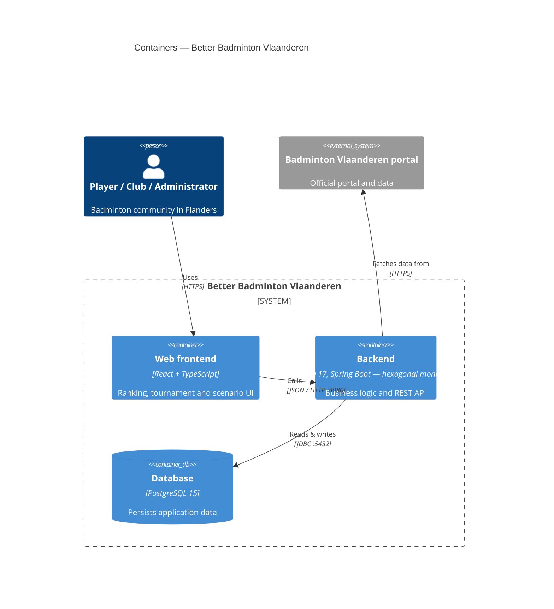
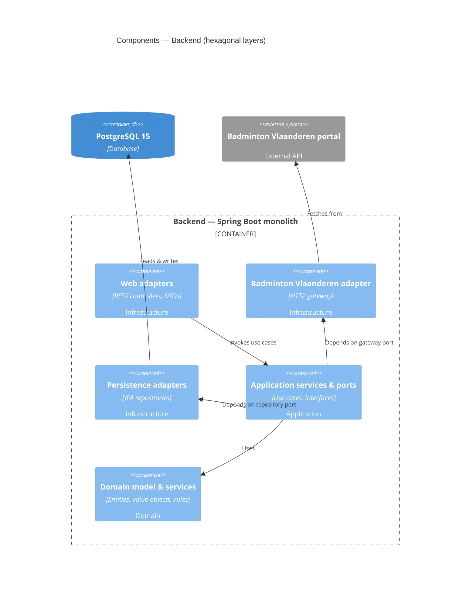

# C4 diagrams

C4 model of the **current** architecture: a hexagonal Spring Boot monolith with PostgreSQL, a
React + TypeScript frontend, and the external Badminton Vlaanderen portal. Facts are taken
from `docker-compose.yml` and the architecture section of
[`DOCUMENTATION.md`](../../DOCUMENTATION.md). The planned mobile app is intentionally omitted
until it exists.

## Level 1 — System context

## Level 2 — Containers

## Level 3 — Components (backend)

> Drawn at the documented hexagonal-layer granularity (`infrastructure` / `application` /
> `domain`). The backend currently holds configuration only, so concrete components are
> illustrative of the layer structure. <PLACEHOLDER> — refine into real components as the
> backend is implemented; keep the layer dependencies (infrastructure → application →
> domain; application never imports infrastructure).

