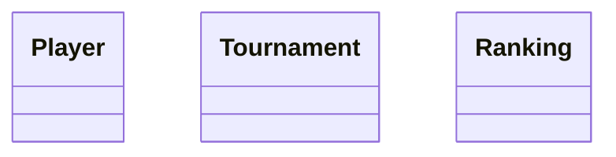

# Data model (UML)

Domain / data-model class diagram for the backend.

> **Scaffold — not yet populated.** The backend currently contains configuration only
> (no domain Java), so there is no implemented data model to draw. The classes below are the
> domain concepts named in [`DOCUMENTATION.md`](../../DOCUMENTATION.md) (Player, Tournament,
> Ranking), shown as empty placeholders. <PLACEHOLDER> — replace with the real aggregates,
> value objects, fields and relations as the domain is implemented.
>
> TODO: as each aggregate lands, add its value objects (ids, ranking/index values, dates and
> ranges, scores) and relations here, in the same change that introduces them. Prefer
> validated value objects over raw primitives (see `AGENTS.md` doctrines).

